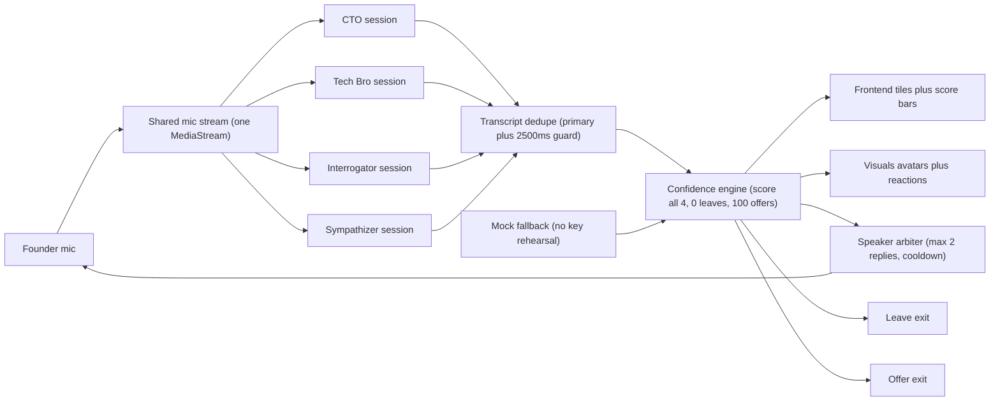

# investor-verdict

Teams style call where you pitch to 4 live voice investors and survive to term sheet.

## How to watch demo

Live demo: https://investor-verdict-1.onrender.com (Render display name is investor-verdict, URL slug is investor-verdict-1).

Health check: GET https://investor-verdict-1.onrender.com/health must return ok true.

Start with the live demo, then play the screen recording for the full pitch arc.

* Call grid: `docs/screenshots/call-grid.png` (placeholder, capture 4 tiles plus founder tile)
* Score bars: `docs/screenshots/score-bars.png` (placeholder, capture bars mid pitch plus one mover)
* Screen recording: `docs/demo.mp4` (placeholder, 60 to 90 seconds, mic on, two replies max per turn)
* Investor portraits: `visuals/investors/` (portrait art lands here, referenced by tiles and avatars)
* Confidence preview: `visuals/confidence/preview.jpg` (existing still, use while screenshots are pending)

Shot list and recording script live in `docs/demo.md`.

## How to run 60 second quickstart

Fastest path: open the hosted demo at https://investor-verdict-1.onrender.com, then confirm GET /health on the same host returns ok true.

1. Clone and enter the repo: `git clone <repo url>` then `cd investor-verdict`
2. Checkout this branch: `git checkout feat/agents/4-agent-live-system`
3. Copy env and fill 4 public agent IDs: `cp agents/.env.example .env`
4. Open the call UI: frontend confidence panel (`frontend/confidence-panel/src/main.ts` plus `index.html`, from commit `8fc2a39`) or the visuals demo (`visuals/confidence/demo.html`)
5. Pick mock for no key rehearsal, or live for voice, grant mic for live, then pitch

Env keys inside `agents/.env.example`:

```
ELEVENLABS_AGENT_ID_CTO=agent_cto_placeholder
ELEVENLABS_AGENT_ID_TECH_BRO=agent_tech_bro_placeholder
ELEVENLABS_AGENT_ID_INTERROGATOR=agent_interrogator_placeholder
ELEVENLABS_AGENT_ID_SYMPATHIZER=agent_sympathizer_placeholder
```

Live browser voice uses public agent IDs only. The API key stays server side for signed URLs. Never commit `.env`.

Hosted verify: GET https://investor-verdict-1.onrender.com/health must return ok true, and POST /api/signed-url on the same host with `{"agentKey": "cto"}` must return signedUrl JSON.

## Meet the panel

<table>
<tr><th>Title</th><th>Lens</th><th>Deal rank</th></tr>
<tr><td>CTO</td><td>Market finance (TAM, pricing, paid traction)</td><td>2, Solid Terms</td></tr>
<tr><td>Tech Bro</td><td>Arch creativity (novel build, scale, tradeoffs)</td><td>3, Creative Bet</td></tr>
<tr><td>Interrogator</td><td>Veteran, hardest (profit per unit, cash payback)</td><td>1, Best Deal</td></tr>
<tr><td>Sympathizer</td><td>Warmest (story, mission, user love)</td><td>4, Smallest Warm Check</td></tr>
</table>

Personas and deal profiles are defined in `agents/config.js`. Start scores default to 50 each.

## Live interaction loop

1. Speak once into a single mic, all 4 sessions hear it through one shared stream
2. Transcripts dedupe to one founder turn (primary session plus 2500ms repeat guard)
3. All 4 investors score every turn through the confidence engine (deltas 5 to 15)
4. Max 2 investors reply per turn, picked by addressed Title, then largest delta, then round robin
5. Score bars move on tiles and avatars, voices react, tension builds
6. Score 0 leaves the call, score 100 offers a term sheet, terminal investors freeze

## Systems model



Single mic fans out to 4 ElevenLabs sessions. Deduped transcript feeds one engine. Engine drives frontend tiles, visuals avatars, and the arbiter. Arbiter gates audio back to the founder. Mock fallback keeps rehearsal alive with no key.

## Architecture

* MVP realtime design: `docs/architecture.md`
* Components, data flow, env vars, failure modes, branch map
* Agent contracts and mock mode: `agents/README.md`

## Team roles

<table>
<tr><th>Area</th><th>Scope</th></tr>
<tr><td>Frontend</td><td>Video call UI, tiles, score state in frontend confidence panel</td></tr>
<tr><td>Visuals</td><td>Avatars, reactions, portraits in visuals investors plus confidence demo</td></tr>
<tr><td>Agents</td><td>ElevenLabs wiring, scoring, arbiter in agents live client plus engine</td></tr>
</table>

## Submission note

Larphacks 2026 submission is at 6pm. Freeze features 60 minutes before deadline, rehearse the demo, record the backup clip.
